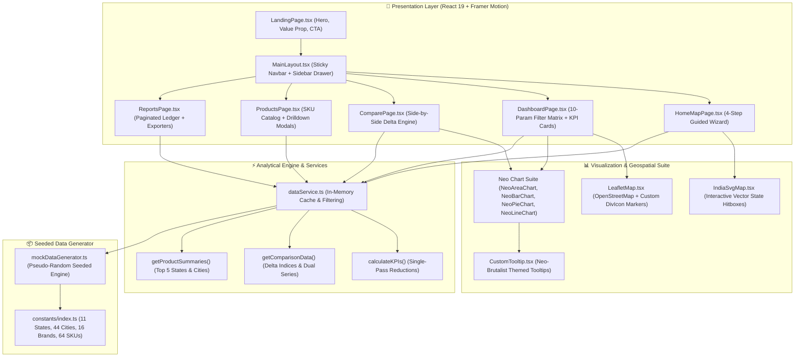
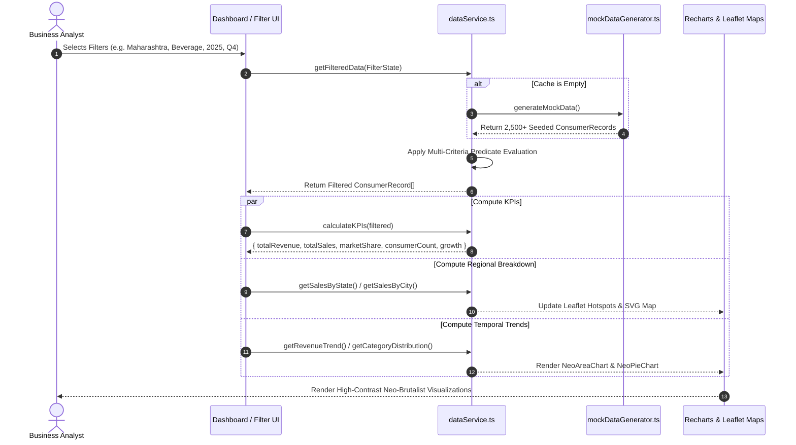
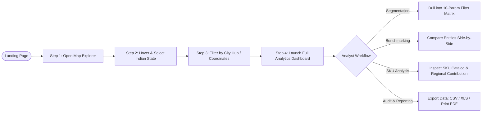
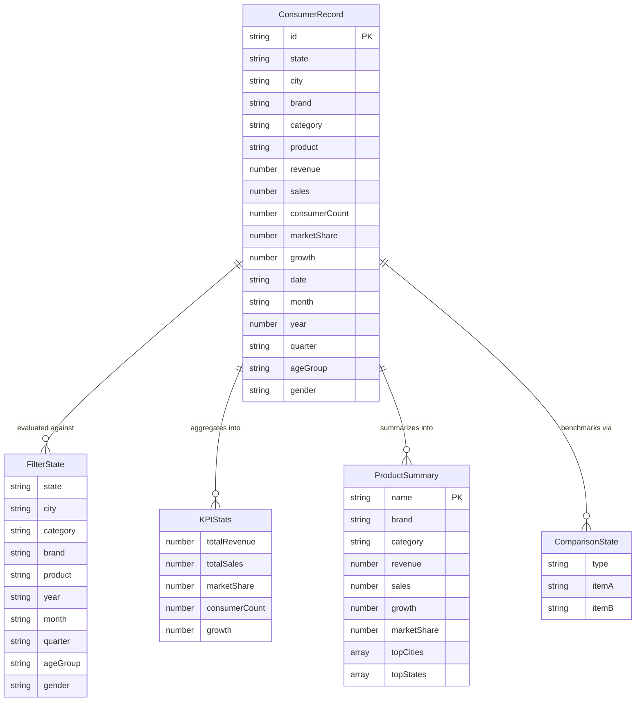

# ⚡ MarketPulse AI

> **Consumer Consumption Intelligence & Spatial Analytics Platform for Indian Regional Markets**

[](https://react.dev/)
[](https://www.typescriptlang.org/)
[](https://vitejs.dev/)
[](https://tailwindcss.com/)
[](https://www.framer.com/motion/)
[](https://leafletjs.com/)
[](https://recharts.org/)
[](LICENSE)

---

## 📌 Table of Contents

- [Overview](#-overview)
- [The Problem It Solves](#-the-problem-it-solves)
- [System Architecture](#-system-architecture)
- [Data Flow & Processing Pipeline](#-data-flow--processing-pipeline)
- [User Journey & Geographic Drilldown](#-user-journey--geographic-drilldown)
- [Data Model & Entity Schema](#-data-model--entity-schema)
- [Key Features](#-key-features)
- [Design System: Premium Neo-Brutalism](#-design-system-premium-neo-brutalism)
- [Project Directory Structure](#-project-directory-structure)
- [Getting Started](#-getting-started)
- [Available Scripts](#-available-scripts)
- [Comprehensive Technical Documentation](#-comprehensive-technical-documentation)
- [Contributing & License](#-contributing--license)

---

## 🧭 Overview

**MarketPulse AI** is an enterprise-grade consumer consumption intelligence and spatial analytics dashboard specifically engineered for Indian regional markets. In fast-moving consumer goods (FMCG), electronics, apparel, and personal care, national aggregate metrics consistently mask hyper-local consumption behaviors, seasonal demand shifts, and tier-2 city growth anomalies.

MarketPulse AI bridges this gap by delivering **sub-second, multi-dimensional market visibility** through a tactile, high-contrast **Neo-Brutalist** user interface. It combines vector SVG territory drilldowns, geospatial Leaflet coordinate mapping, multi-tier cascading filtering, side-by-side competitor benchmarking, and audit-ready data export capabilities.

```
       All-India Macro View (National Trends & Multi-Category Sales)
                                    │
                                    ▼
       11 Strategic States (State Hitboxes, KPI Previews, Share Dips)
                                    │
                                    ▼
       44 Metropolitan & Tier-2 Hubs (Geospatial Leaflet Coordinates)
                                    │
                                    ▼
       64 Specific SKUs across 16 Brands & 10 Demographic Parameters
```

---

## 💡 The Problem It Solves

| Traditional Market Intelligence | MarketPulse AI Solution |
|---|---|
| **Masked Localized Realities:** National aggregates hide festive spikes (e.g., Diwali in Q4) and state-specific demand drops. | **Hyper-Local Precision:** Granular drilldown into 11 states and 44 major cities with state-level revenue and consumer footfalls. |
| **Clunky Spreadsheet Queries:** Analysts wait for complex SQL queries or juggle fragmented pivot tables. | **Sub-Second Client-Side Aggregations:** In-memory caching and single-pass reductions for instantaneous dashboard updates. |
| **Boring, Generic Dashboards:** Standard corporate templates with muted gray charts that lack visual hierarchy. | **Premium Neo-Brutalism:** Bold 3px/4px solid borders, flat offset box shadows, vibrant high-contrast accents, and fluid Framer Motion micro-animations. |
| **Fragmented Benchmarking:** Comparing competing regions or brands requires manual copy-pasting across sheets. | **Automated Delta Intelligence:** Head-to-head comparison engine with auto-computed percentage deltas and dual-series trajectory lines. |

---

## 🏛️ System Architecture

MarketPulse AI follows a clean, modular architecture separating presentation components, custom visualization wrappers, client-side analytical services, and deterministic data generation.



---

## 🔄 Data Flow & Processing Pipeline

The platform uses client-side analytical caching for instantaneous responses to multi-parameter filters without network roundtrips:



---

## 🗺️ User Journey & Geographic Drilldown



---

## 🧬 Data Model & Entity Schema



---

## ✨ Key Features

### 1. 🇮🇳 Interactive Geographic Drilldown (`IndiaSvgMap.tsx`)
- High-fidelity vector SVG map of India highlighting **11 core commercial states**: *Maharashtra, Delhi NCR, Karnataka, Tamil Nadu, Gujarat, Telangana, West Bengal, Rajasthan, Uttar Pradesh, Kerala, Punjab*.
- Interactive cursor hitboxes with dynamic tooltip previews displaying active state sales and consumer counts.
- 4-step interactive guided wizard on `/map-selector` allowing analysts to isolate target regional zones before navigating into deep analytics.

### 2. 📍 Geospatial Leaflet Hotspots (`LeafletMap.tsx`)
- Real geographic coordinate mapping across **44 major metropolitan and tier-2 city hubs**.
- OpenStreetMap raster base layer overlaid with customized HTML `L.DivIcon` circular markers color-coded by revenue volume.
- Interactive popups displaying localized revenue metrics, sales volume, and quick-filter actions.

### 3. 🎛️ 10-Parameter Cascading Filter Matrix (`DashboardPage.tsx`)
- Concurrent multi-dimensional filtering across:
  - **Geography:** State, City
  - **Merchandise:** Category, Brand, Product SKU
  - **Temporal:** Year (2024, 2025, 2026), Quarter (Q1–Q4), Month (Jan–Dec)
  - **Demographics:** Age Cohort (`18-24`, `25-34`, `35-44`, `45-54`, `55+`), Gender (`Male`, `Female`, `Other`)
- Built-in cascading reset handlers: changing a state automatically resets city selections; changing category resets downstream brand and SKU choices.

### 4. 📈 Real-Time Executive KPI Metric Cards (`DashboardPage.tsx`)
- Immediate calculation of 5 core business health indicators:
  - 💰 **Total Revenue:** Displayed in Crores (₹ Cr) or Lakhs (₹ L)
  - 📦 **Unit Sales:** Total volume sold across active filters
  - 📊 **Mean Market Share:** Average category market share percentage
  - 👥 **Consumer Footfall:** Distinct consumer interactions
  - 🚀 **YoY Growth Rate:** Year-over-year revenue velocity indicator

### 5. 🥊 Head-to-Head Comparison Intelligence Engine (`ComparePage.tsx`)
- Benchmark any two entities side-by-side across 5 comparison dimensions:
  - `State vs State` (e.g. Maharashtra vs Karnataka)
  - `City vs City` (e.g. Mumbai vs Bengaluru)
  - `Brand vs Brand` (e.g. Samsung vs Apple)
  - `Category vs Category` (e.g. FMCG vs Electronics)
  - `Product vs Product` (e.g. iPhone 15 Pro vs Galaxy S24 Ultra)
- Automatically computes **Delta Margins** (`+X.XX%` or `-X.XX%`), renders dual-series historical revenue trends, and contrasts top SKU performers.

### 6. 🏷️ SKU Product Catalog & Drilldown Modal (`ProductsPage.tsx`)
- Card-based showcase of all 64 products across 16 brands and 4 core categories.
- Real-time search by product name and quick category filtering.
- Interactive **"View Drilldown"** modal dialog displaying national revenue, unit volume, growth rate, and top-5 contributing states and cities with progress-bar contribution visualizers.

### 7. 📄 Enterprise Reports Ledger & Multi-Format Exporters (`ReportsPage.tsx` & `Table.tsx`)
- Full-featured tabular view with client-side multi-column sorting and pagination.
- **Client-Side CSV Export:** Generates clean, RFC-4180 compliant CSV files with automated timestamped naming.
- **Excel Export (.xls):** Generates tab-delimited Excel files compatible with Microsoft Excel and Google Sheets.
- **Print / PDF Ready:** Clean `@media print` CSS rules allowing browser native save-as-PDF without sidebar clutter.

---

## 🎨 Design System: Premium Neo-Brutalism

MarketPulse AI implements an intentionally tactile, high-contrast Neo-Brutalist aesthetic defined in [design.md](design.md) and [index.css](src/index.css).

```
   ┌────────────────────────────────────────┐
   │  NEO-BRUTALIST CARD                     │
   │  ┌──────────────────────────────────┐  │
   │  │  Border: 3px solid #111111       │  │
   │  │  Shadow: 4px 4px 0px 0px #111111 │  │
   │  │  Radius: rounded-2xl             │  │
   │  └──────────────────────────────────┘  │
   └────────────────────────────────────────┘
```

### Color Palette

| Token | Hex | Role |
|---|---|---|
| `--color-primary-blue` | `#4F7DF9` | Primary buttons, active nav, logo, accent text |
| `--color-yellow` | `#FFD54A` | CTA buttons, active pills, highlight badges |
| `--color-green` | `#6EE7B7` | Success metrics, positive growth, healthy KPIs |
| `--color-pink` | `#FF9ECF` | Feature highlights, floating cards, badges |
| `--color-orange` | `#FFB347` | Warning states, secondary chart series |
| `--color-red` | `#FF6B6B` | Negative growth, danger alerts |
| `--color-bg-base` | `#FAFAFA` | Page background, light canvas |
| `--color-dark-base` | `#111111` | Borders, hard shadows, headings, footer |

### Typography

- **Headings & Display:** [Space Grotesk](https://fonts.google.com/specimen/Space+Grotesk) — Bold, geometric uppercase styling.
- **Body & Controls:** [Poppins](https://fonts.google.com/specimen/Poppins) — Highly legible sentence-case font for data grids and UI labels.

---

## 📂 Project Directory Structure

```
MarketPulse/
├── public/                       # Static public assets
├── src/
│   ├── assets/                   # Brand icons, SVGs, and graphics
│   ├── charts/                   # Neo-Brutalist Recharts wrappers
│   │   ├── CustomTooltip.tsx     # Custom Neo-styled chart tooltip
│   │   ├── NeoAreaChart.tsx      # Multi-gradient historical area chart
│   │   ├── NeoBarChart.tsx       # Bold border bar chart
│   │   ├── NeoLineChart.tsx      # Dual-series comparison line chart
│   │   ├── NeoPieChart.tsx       # Neo-Brutalist donut/pie chart
│   │   └── index.ts              # Unified chart exports
│   ├── components/               # Atomic reusable Neo-Brutalist components
│   │   ├── Badge.tsx             # Pill badges with colored borders
│   │   ├── Button.tsx            # Neo tactile click/press buttons
│   │   ├── Card.tsx              # Elevated cards with offset shadows
│   │   ├── Dropdown.tsx          # Filter selection dropdowns
│   │   ├── EmptyState.tsx        # Zero-state illustration placeholders
│   │   ├── Input.tsx             # Text search and form inputs
│   │   ├── LoadingSkeleton.tsx   # Shimmering wireframe placeholders
│   │   ├── Modal.tsx             # Framer Motion animated modal dialogs
│   │   ├── Navbar.tsx            # Sticky header with quick actions
│   │   ├── Sidebar.tsx           # Mobile & desktop drawer navigation
│   │   └── Table.tsx             # Paginated sorting table with CSV/XLS export
│   ├── constants/
│   │   └── index.ts              # States, cities, categories, brands & SKUs
│   ├── layouts/
│   │   └── MainLayout.tsx        # Shell layout combining Navbar + Sidebar
│   ├── maps/
│   │   ├── IndiaSvgMap.tsx       # Vector SVG map with interactive state hitboxes
│   │   └── LeafletMap.tsx        # Leaflet + OpenStreetMap city markers
│   ├── pages/
│   │   ├── AboutPage.tsx         # Platform methodology and mission
│   │   ├── ComparePage.tsx       # Head-to-head benchmarking engine
│   │   ├── DashboardPage.tsx     # Main analytics cockpit & filter matrix
│   │   ├── HomeMapPage.tsx       # 4-step interactive map wizard
│   │   ├── LandingPage.tsx       # Hero landing page & showcase
│   │   ├── ProductsPage.tsx      # SKU catalog with detail modals
│   │   ├── ReportsPage.tsx       # Tabular data ledger & export suite
│   │   └── SettingsPage.tsx      # Profile configuration & preferences
│   ├── routes/
│   │   └── index.tsx             # React Router v7 route hierarchy
│   ├── services/
│   │   └── dataService.ts        # Client-side analytical query service
│   ├── types/
│   │   └── index.ts              # Core TypeScript interfaces & types
│   ├── utils/
│   │   └── mockDataGenerator.ts  # Seeded deterministic mock dataset generator
│   ├── App.css                   # Component-level styling overrides
│   ├── App.tsx                   # Top-level application shell
│   ├── index.css                 # TailwindCSS v4 tokens & Neo utility classes
│   └── main.tsx                  # React DOM entry point
├── design.md                     # Complete Design System specification
├── generate_documentation_pdf.py # ReportLab Python script for project documentation
├── MarketPulse_AI_Complete_Project_Documentation.pdf # Comprehensive audit PDF
├── index.html                    # HTML entry template with Google Fonts
├── package.json                  # Dependencies and execution scripts
├── tsconfig.json                 # TypeScript project configuration
└── vite.config.ts                # Vite build and plugin configurations
```

---

## 🚀 Getting Started

### Prerequisites

- [Node.js](https://nodejs.org/) (`v18.0.0` or higher recommended)
- `npm` (bundled with Node.js) or `pnpm` / `yarn`

### Installation

1. **Clone the repository:**
   ```bash
   git clone https://github.com/ParthYendhe0679/MarketPulse.git
   cd MarketPulse
   ```

2. **Install project dependencies:**
   ```bash
   npm install
   ```

3. **Start the local development server:**
   ```bash
   npm run dev
   ```
   Open your browser and navigate to `http://localhost:5173`.

4. **Build for production:**
   ```bash
   npm run build
   ```
   Production assets will be output to the `dist/` directory.

5. **Preview production build locally:**
   ```bash
   npm run preview
   ```

---

## 🛠️ Available Scripts

| Command | Action |
|---|---|
| `npm run dev` | Launches local Vite development server with Hot Module Replacement (HMR) |
| `npm run build` | Runs TypeScript type-checking (`tsc -b`) and bundles production assets with Vite |
| `npm run preview` | Spins up a local server to test the production build |
| `npm run lint` | Runs `oxlint` for high-speed JavaScript/TypeScript static analysis |

---

## 📚 Comprehensive Technical Documentation

This repository contains a publication-grade, 8-page academic & architectural audit report generated via ReportLab:

- 📄 **PDF Document:** [`MarketPulse_AI_Complete_Project_Documentation.pdf`](MarketPulse_AI_Complete_Project_Documentation.pdf)
- 🐍 **Generator Script:** [`generate_documentation_pdf.py`](generate_documentation_pdf.py)

The documentation covers:
- System Architecture, Layering, and Component Responsibility Matrix
- Implementation Verification Audit (Verified working features vs future roadmap)
- Mathematical Formulations for Revenue, Sales, Market Share & YoY Growth
- Viva-Voce / Technical Interview Questions & Answers
- Future Extensibility (FastAPI backend integration, PostgreSQL schemas, and Prophet forecasting)

---

## 📄 License & Attribution

Distributed under the **MIT License**. See `LICENSE` for more information.

Developed with ❤️ for regional Indian market intelligence.
